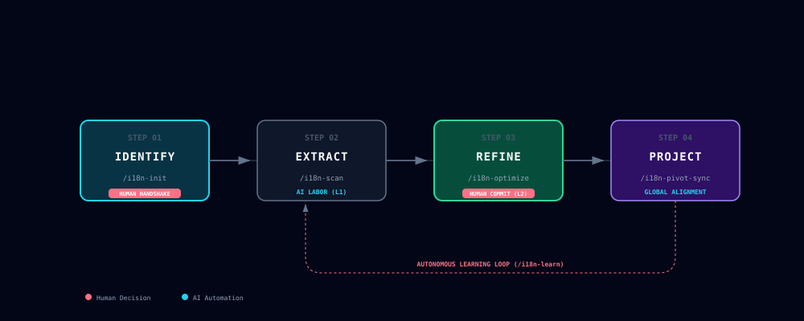

# i18n-agent-skill 🌐

**English** | [简体中文](./README.zh-CN.md) · [**Interactive Docs & Showcase ↗**](https://shirolin.github.io/i18n-agent-skill/)

> **Industrial-grade frontend internationalization (i18n) lifecycle automation for AI coding assistants.**

[](https://shirolin.github.io/i18n-agent-skill/)
[](CHANGELOG.md)
[](https://github.com/FrancyJGLisboa/agent-skill-creator)
[](https://tree-sitter.github.io/)
[](LICENSE)

**i18n-agent-skill** provides full-lifecycle orchestration for internationalization within AI-native development workflows. By leveraging deterministic AST parsing and a "human-in-the-loop" staging mechanism, it minimizes hardcoded string leakage while ensuring predictable and verified translation quality.

---

## 🔄 How It Works (Continuous Iteration)

**i18n-agent-skill** is designed to be a continuous companion during your development lifecycle. As you build new features or refactor old ones, the cycle repeats—getting smarter with every iteration.



1.  **Identify**: The AI performs a "handshake" with your project to understand its unique tone (e.g., *Financial Professional*). Done once at setup.
2.  **Extract & Audit**: Whenever you add new pages or logic, the AI precision-scans the AST to capture new strings and find missing translations.
3.  **Refine & Commit**: AI experts polish your draft in a staging area. Once you **Commit**, the system learns these choices and locks them as "Policy."
4.  **Sync**: Verified high-quality translations are projected globally to all other languages instantly.
5.  **Iterate**: Developing a new feature? Jump back to **Step 2**. Your i18n assets now evolve in lock-step with your code.

---

## 🚀 Installation

### Option 1: Ask Your AI (Recommended)

Copy the following prompt and send it to your AI coding assistant (e.g., Cursor, Claude Code, Gemini CLI):

**One-Step Setup (Recommended)**
```text
Setup this i18n skill for my current project and initialize it: https://github.com/Shirolin/i18n-agent-skill
```

AI should clone the repo, run the installer, then initialize the project with a valid entrypoint.
`init` detects project locale assets first and then chooses sync/bootstrap/diagnostic behavior.
Do not assume `./i18n` exists until the installer has generated a project-level proxy.

### Option 2: Manual Installation

```bash
# Clone to workspace (Recommended)
git clone --depth 1 https://github.com/Shirolin/i18n-agent-skill .agents/skills/i18n-agent-skill
cd .agents/skills/i18n-agent-skill

# Run Installer
./install.sh       # Linux / macOS
.\install.ps1      # Windows (PowerShell)
```

After installation, run the initialization command in your project root:
```bash
# If your platform maps slash commands:
/i18n-init

# If the installer generated a project-level proxy:
./i18n init          # Linux / macOS
.\i18n.ps1 init      # Windows (PowerShell)

# Direct Python entrypoint:
python -m i18n_agent_skill init
```

### Choose the Right Entrypoint

Use the command form that actually exists in your environment:

- **Slash command**: `/i18n-init`, `/i18n-status`, etc. Only when your MCP/platform maps them.
- **Project proxy**: `./i18n` or `.\i18n.ps1` only after the installer has generated them in the target project root.
- **Direct Python**: `python -m i18n_agent_skill <command>` always reflects the underlying CLI.

`init --auto` is currently a compatibility flag for guided setup. It does **not** auto-save persona or skip confirmation steps.

### Updating

```bash
cd <install_path>/i18n-agent-skill
git pull
./install.sh       # Linux / macOS
.\install.ps1      # Windows (PowerShell)
```

The skill automatically detects when a newer version is available and notifies you.

---

## 🛡️ Key Features

### 1. Deterministic AST Parsing
Unlike fragile RegEx-based extractors, our engine uses **Tree-sitter AST** to navigate code structure.
- **Structural Accuracy**: Correctness in complex JSX/TSX nesting and template literals.
- **Zero-Noise Isolation**: Automatically ignores comments and non-UI code blocks.
- **Multi-Format Parsing**: Robust support for JSON, YAML, and JS/TS object-literal locale files.

### 2. Privacy Shield (Secure by Design)
Built for enterprise security. Your source code and sensitive data stay in your local environment.
- **Local Masking**: Automatically masks extracted text and returned code context before AI interaction. Basic mode covers emails and API keys; strict mode also covers IPs, phone numbers, and ID numbers.
- **Deterministic Hashing**: Tracks changes via local hashes without ever uploading content.

### 3. State-Based Quality Evolution
Manages the translation lifecycle to prevent regressions and improve phrasing over time.
- **State Machine**: Tracks every key from `DRAFT` to `REVIEWED` and `APPROVED`.
- **Glossary Memory**: Saves confirmed terminology in the local glossary for later reuse.
- **Typography Linter**: Built-in rules for CJK-Western spacing and professional punctuation.

---

## 🌍 Language Support Matrix

| Language Family | Extraction (AST) | Translation (AI) | Typography Linting | Status |
| :--- | :---: | :---: | :---: | :--- |
| **English / Western** | ✅ | ✅ | ✅ | **Production** |
| **CJK (ZH, JA, KO)** | ✅ | ✅ | ✅ | **Production** |
| **European (Latin)** | ✅ | ✅ | ✅ | **Stable** |
| **RTL (Arabic, Hebrew)**| ✅ | ✅ | ⚠️ (Bypass) | **Beta (Sync only)** |
| **Other (Hindi, Thai)** | ✅ | ✅ | ⚠️ (Bypass) | **Beta (Sync only)** |

> **Note**: Professional typography rules (e.g., CJK spacing) are currently optimized for language families marked as "✅".

---

## 📖 Core Command Set (AI & Human Reference)

| Command | Capability | Detailed Functional Description |
| :--- | :--- | :--- |
| `/i18n-init` | **Initialization** | Detects project i18n state first, then returns `sync`, `bootstrap`, `reconcile`, `unsupported`, or `hard_fail` with concrete next steps. |
| `/i18n-status` | **Health Check** | Verifies dependencies, environment isolation, and current VCS (Git) state. |
| `/i18n-scan` | **Extraction** | Precision scan of source code to find hardcoded strings. Use `--path` for specific components or `--vcs` for current Git diff hunks. |
| `/i18n-audit` | **Gap Analysis** | Compares locale files against source code to find missing keys and report unextracted hardcoded-string candidates. |
| `/i18n-sync` | **Smart Staging** | Generates translation proposals from a flat `{key: translation}` payload. It rejects optimize task files and other wrapped artifacts. |
| `/i18n-commit` | **Apply Changes** | Formally writes approved proposals to physical locale files and updates quality snapshots. |
| `/i18n-cleanup` | **Debt Control** | Report-only dead-key detection. Review keys first; do not run ad-hoc deletion scripts directly on locale files. |
| `/i18n-audit-quality` | **Expert Audit** | Generates a quality report focusing on phrasing, variable safety, and typography. |
| `/i18n-pivot-sync` | **Projection** | Optimizes target languages based on a familiar reference language (e.g., zh-CN). |
| `/i18n-optimize` | **Optimization Task Export** | Exports an optimize task file containing `targets` and `dynamic_glossary`. This file is not a sync payload and must not be passed directly to `sync`. |

---

## 🧭 Recommended Workflows

### Already-Internationalized Project

1. Run `i18n init`.
2. Confirm `mode=sync`.
3. Run `i18n status`.
4. Run `i18n audit --lang all`.
5. During day-to-day development, prefer `i18n scan --vcs` to measure only the current change set.

### New Project / First i18n Bootstrap

1. Run `i18n init`.
2. Confirm `mode=bootstrap`.
3. Create the base locale file, usually `src/locales/en.json`.
4. Add target languages after the base locale exists.
5. Run `i18n status`, then `i18n audit --lang all`.

### Ambiguous Existing Project

1. Run `i18n init`.
2. If `mode=reconcile`, stop there.
3. Review the reported locale root candidates.
4. Confirm the intended locale root before running `audit`, `sync`, or `cleanup`.

### Optional Persona Workflow

If you want persona-aware optimization, do it explicitly:

1. `i18n distill-persona`
2. Human review and confirmation
3. `i18n save-persona --data ...`

### Cleanup Safety

- `i18n cleanup` is **report-only**.
- It does **not** generate deletion scripts.
- Delete locale keys manually in small batches.
- Run VCS diff, type-check, and tests after each batch.

### Translation Optimization Workflow

1. Run `i18n optimize --lang <lang>`.
2. Review the returned `summary` and `pending_confirmation` fields first.
3. Treat `temp/opt_<lang>.json` as an optimization task file, not a locale patch.
4. Read only its `targets` entries and produce a flat `{key: translation}` JSON object.
5. Run `i18n sync --lang <lang> --data <pure-json-or-file>`.
6. Run `i18n commit --proposal <lang>`, then `i18n audit --lang <lang>` and type-check/tests.

`dynamic_glossary` is reference context only. It must never be written into locale files.
`temp/opt_<lang>.json` is an intermediate artifact. Review its `cleanup` guidance before deleting it.

## 🤖 Integration Blueprint

This skill follows the **Agent Skills Open Standard (ADK)** and installs to the universal path:

| Scope | Install Path | Who reads it |
| :--- | :--- | :--- |
| **Workspace** | `.agents/skills/i18n-agent-skill/` | Any ADK-compatible agent in this project |
| **Global** | `~/.agents/skills/i18n-agent-skill/` | Any ADK-compatible agent system-wide |

For platforms that don't read the ADK path natively, run `./install.sh --link-platforms` to create optional symlinks (e.g., `~/.gemini/skills/`, `~/.claude/skills/`).


---

## 📂 Project Structure

```text
i18n-agent-skill/
├── i18n_agent_skill/   # Core Python logic package
├── scripts/            # Automation: installers, cleanup, and wrappers
├── references/         # Knowledge base: AST engine, Privacy Guard, Linting specs
├── assets/             # Templates: glossary, persona blueprints
├── tests/              # Full suite: Unit, integration, and resilience tests
├── SKILL.md            # Execution protocol (v4.0 Spec)
└── pyproject.toml      # Dependency and project index
```

---

## 🛠 Engineering Quality

This project maintains industrial-grade standards through automated verification tools:

```bash
# 1. Full Quality Audit (Ruff Format/Lint + Mypy Type Check)
python scripts/check.py

# 2. Automated Test Suite (58+ Unit & Integration Tests)
pytest

# 3. Protocol Compliance (Optional)
python .agents/skills/agent-skill-creator/scripts/validate.py .
```

---

## 🔒 Security & Privacy

We guarantee that **zero source code** is uploaded to third-party servers. All AST parsing, de-identification, and suggestion generation occur locally. AI agents only receive masked snippets required for translation assistance under your explicit permission.

---

## 💖 Support the Project

If you find **i18n-agent-skill** helpful, please consider:
- Giving the project a **Star** ⭐ to show your support.
- **Afdian**: [https://ifdian.net/a/shirolin](https://ifdian.net/a/shirolin)
- **Ko-fi**: [https://ko-fi.com/shirolin](https://ko-fi.com/shirolin)

---

---

## 🔍 Deep Dive

- **[Product Scenarios](./references/product-scenarios.md)**: Detailed 5-phase lifecycle and authority hierarchy (L1-L3).
- **[AST Engine](./references/ast-engine.md)**: How our Tree-sitter integration ensures pixel-perfect extraction.
- **[Privacy Guard](./references/privacy-guard.md)**: Specification for local data masking and security.

## 📄 License

Licensed under [Apache-2.0](LICENSE).
